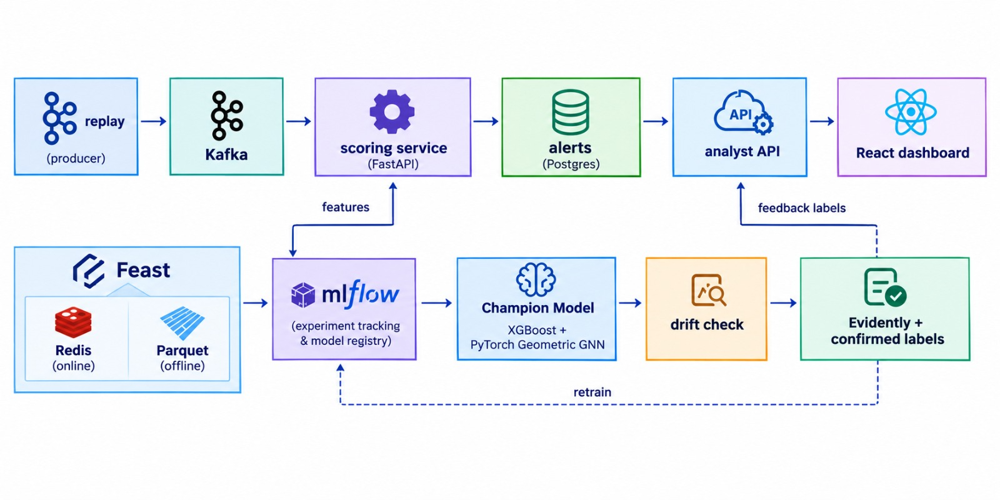

# Real-Time Financial Fraud Detection Platform

Scores payment transactions as they arrive, combines a tabular model with a graph model to catch connected
fraud, sends suspicious payments to an analyst dashboard, and retrains itself when traffic changes.



```
replay ──► Kafka ──► scoring service ──► alerts ──► analyst API ──► React dashboard
(producer)            FastAPI                        Postgres            │
                      │    ▲                                             │ feedback labels
             features │    │ champion model                              ▼
                    Feast  MLflow ◄── retrain ◄── drift check ◄── Evidently + confirmed labels
              (Redis online,          XGBoost + PyTorch Geometric GNN
               Parquet offline)
```

Read [docs/DESIGN.md](docs/DESIGN.md) before a viva. It explains every design decision and lists the defects that
only appeared when the system ran end to end. [docs/MODEL_CARD.md](docs/MODEL_CARD.md) covers limitations.

## Important: the results below are not from a real dataset

Kaggle could not be reached from where this was built, so **every number in this README and in
`reports/results/` comes from a synthetic generator**. It writes files in the exact IEEE-CIS format, so the real
loader and pipeline were exercised, but its fraud patterns were planted. Those numbers prove that the system
works. They say nothing about real fraud detection. **Run on IEEE-CIS and replace them before you submit**
(see [Use the real dataset](#use-the-real-dataset)).

Also note that the brief says fraud is under 1%, but IEEE-CIS is about 3.5%. Report the figure from your own
`reports/eda.md`.

## How the brief maps to the code

| Step in the brief | Where | Check it with |
|---|---|---|
| 1. Dataset and EDA | `src/fraudlib/data/`, `reports/eda.md` | `python -m fraudlib.pipeline eda` |
| 2. Features in Feast | `src/fraudlib/features/engine.py`, `feature_repo/` | `scripts/verify_parity.py` |
| 3. XGBoost, class weights or SMOTE, PR-AUC, MLflow | `train_xgb` in `src/fraudlib/pipeline.py` | MLflow UI, port 5000 |
| 4. Graph, GNN, blend | `src/fraudlib/models/gnn.py`, `train_gnn` | `data/artifacts/evaluation.json` |
| 5. Kafka producer, FastAPI consumer | `producer/replay.py`, `services/scoring/app.py` | `/stats` on port 8000 |
| 6. Evidently and automatic retraining | `src/fraudlib/monitor/drift.py` | Dashboard, Overview tab |
| 7. React dashboard, Kubernetes | `frontend/`, `services/analyst/app.py`, `deploy/k8s/` | Port 8080, or NodePort 30080 |

## Results on the synthetic data

200,000 transactions split by time, 60/20/20. Test period: 39,990 transactions, 2.5% fraud.

| Model on the test period | PR-AUC | ROC-AUC | Recall at 90% precision |
|---|---|---|---|
| Random baseline | 0.025 | 0.50 | |
| XGBoost | 0.857 | 0.969 | 77.9% |
| GNN alone | 0.500 | 0.753 | 46.1% |
| **Blend** | **0.861** | **0.970** | **78.4%** |

- **Imbalance handling:** no reweighting won on validation (0.858), ahead of SMOTE (0.851) and class weights (0.850).
  All three are in MLflow.
- **The graph's contribution is small and not stable.** It adds 0.004 PR-AUC here and lifts ring recall from 89.6% to
  91.4%, but at 590,000 rows it added only 0.0003. The generator was also tuned to hide rings from tabular features,
  so even this lift is a designed outcome. Measure it on real data before claiming anything.
- **Operating points on the test period:** auto-block 1.9% of traffic at 96.9% precision; review another 1.2% at
  18.6% precision; 83.2% of fraud caught.

| Live system check | Result |
|---|---|
| Training and serving feature parity | 98 columns, 3,000 events, 0 mismatches, score difference 0.0 |
| Live replay of 12,000 events | PR-AUC 0.871, 85% of fraud alerted, 60% of alerts were fraud |
| Single `POST /score` latency, 500 requests | p50 45 ms, p95 68 ms, p99 85 ms |
| Malformed Kafka messages | 6 of 6 sent to the dead-letter topic, consumer kept running |
| Drift on normal traffic | 13% of columns, below the 30% threshold, no retrain |
| Drift on injected shift | 60% of columns, retrain triggered automatically |
| Promotion gate on unseen live data | Challenger 0.875 beat champion 0.867, promoted |
| Hot reload | New model live with no restart |

Caveat on the retrained model: on its gate window, auto-block precision was 89.8%, below the 95% target. Thresholds
set on one period do not always hold on the next, which is another reason a human stays in the loop.

Latency was measured on 2 CPU cores with Redis, MLflow, Kafka and Postgres on the same machine.

## What was and was not tested

| Component | Status |
|---|---|
| Whole pipeline, drift, retrain, hot reload | Run end to end, using environments installed from `requirements/` |
| Scale | 590,000 rows trained in about 9 minutes on 2 cores, peak 5.5 GB of memory |
| Service, MLflow and dashboard Dockerfiles | Built with real `docker build`, on local stand-ins for the base images |
| Kubernetes | Deployed on a real k3s cluster: training job, scoring, analyst, MLflow, dashboard NodePort, replay job, both CronJobs |
| Dashboard | Driven in a real browser at desktop and phone width, in light and dark themes |
| **Apache Kafka itself** | **Not run.** Tests used `kfake`, which speaks the Kafka protocol. `docker-compose.yml` and `deploy/k8s/infra.yaml` use the real `apache/kafka` image |
| **`Dockerfile.trainer`** | **Not built.** The CPU PyTorch index was unreachable. The Kubernetes test supplied the same packages from a host folder |
| **Real `redis`, `postgres`, `nginx`, `node`, `python` images** | **Not pulled.** Stand-ins used the same software on Ubuntu |
| **`docker compose up` and Minikube** | **Not run.** Compose config validates. Kubernetes was tested on k3s, not Minikube |
| **Windows** | **Not tested.** The commands below use Docker so they should behave the same, but expect small issues |

So the first `docker compose up` on your machine is also the first run against real Kafka. If something fails, it
will most likely be there.

## Run it on Windows

You need Docker Desktop with its WSL 2 backend. Give it at least **12 GB of memory and 4 CPUs**. To set this, put the
following in `%USERPROFILE%\.wslconfig`, then run `wsl --shutdown` and restart Docker Desktop:

```ini
[wsl2]
memory=12GB
processors=4
```

All commands run in PowerShell from the project folder.

### 1. Build and train

```powershell
docker compose --profile train build

# Quick start on synthetic data. For real data, see the next section.
docker compose --profile train run --rm trainer python -m fraudlib.data.synthetic --rows 200000 --out data/raw/synthetic
docker compose --profile train run --rm trainer python -m fraudlib.pipeline all --raw data/raw/synthetic

# Prove that training and serving agree. Do this once, before any traffic.
docker compose --profile train run --rm trainer python scripts/verify_parity.py --rows 3000
```

The first build downloads several gigabytes. Training 200,000 rows takes 3 to 5 minutes.

### 2. Start the platform

```powershell
docker compose up -d
```

| Open | For | Sign in |
|---|---|---|
| http://localhost:8080 | Analyst dashboard | `analyst` / `demo123` |
| http://localhost:5000 | MLflow experiments and registry | |
| http://localhost:8000/docs | Scoring API | |
| http://localhost:8000/stats | Live counters and latency | |

### 3. Run the demo

```powershell
# Normal traffic. Alerts appear on the dashboard within seconds.
docker compose --profile replay run --rm producer python producer/replay.py --rate 400 --limit 12000

# How did the live system do against the true labels?
docker compose exec scoring python scripts/live_results.py

# Drift check on normal traffic: expect "stable".
docker compose --profile monitor run --rm monitor python -m fraudlib.monitor.drift

# An analyst works through cases. Or do it yourself on the dashboard.
docker compose exec scoring python scripts/simulate_analyst.py --cases 80 --api http://analyst:8001

# Traffic shifts: larger amounts, different product mix.
docker compose --profile replay run --rm producer python producer/replay.py --rate 500 --limit 12000 --skip 12000 --drift

# Stand-in for a bank's chargeback feed: reveals labels for scored transactions.
docker compose exec scoring python scripts/simulate_chargebacks.py

# Drift crosses the threshold, retraining runs, and the challenger is promoted only if it wins.
docker compose --profile monitor run --rm monitor python -m fraudlib.monitor.drift --retrain
```

Wait about 30 seconds and `http://localhost:8000/health` shows the new model version with no restart. Open the
Overview tab for the drift status and the full Evidently report.

For the trigger to run on its own every 15 minutes, start it as a service:

```powershell
docker compose --profile monitor up -d monitor
```

To reset everything: `docker compose down -v`, then delete the `data` folder.

## Use the real dataset

1. Sign in to Kaggle, open the [IEEE-CIS Fraud Detection](https://www.kaggle.com/c/ieee-fraud-detection/data)
   competition, and accept its rules.
2. Download `train_transaction.csv` and `train_identity.csv` into `data\raw\ieee\`. Using the Kaggle command line:

   ```powershell
   pip install kaggle      # needs your token in %USERPROFILE%\.kaggle\kaggle.json
   kaggle competitions download -c ieee-fraud-detection -p data\raw\ieee
   Expand-Archive data\raw\ieee\ieee-fraud-detection.zip data\raw\ieee
   ```

3. Train, then restart the services so they load the new model:

   ```powershell
   docker compose down -v
   Remove-Item -Recurse -Force data\processed, data\features, data\artifacts, data\feast, data\live, data\monitoring -ErrorAction SilentlyContinue
   docker compose --profile train run --rm trainer python -m fraudlib.pipeline all --raw data/raw/ieee
   docker compose up -d
   ```

4. Update the results tables from `data/artifacts/evaluation.json` and `reports/eda.md`, and update
   `docs/MODEL_CARD.md`.

The per-pattern ring recall only exists for synthetic data, because real data has no answer key. On real data, judge
the graph by comparing the XGBoost and blend rows.

## Deploy on Minikube

```powershell
minikube start --cpus 4 --memory 12288 --disk-size 40g

docker compose --profile train build
foreach ($i in "fraud-service","fraud-trainer","fraud-mlflow","fraud-dashboard") { minikube image load "${i}:latest" }

kubectl apply -k deploy/k8s

# Copy the dataset into the shared volume. Use relative paths: kubectl cp misreads "C:\".
kubectl apply -f deploy/k8s/oneoff/loader.yaml
kubectl -n fraud wait --for=condition=Ready pod/loader --timeout=180s
kubectl -n fraud exec loader -- mkdir -p /app/data/raw/ieee
kubectl -n fraud cp data/raw/ieee/train_transaction.csv loader:/app/data/raw/ieee/train_transaction.csv
kubectl -n fraud cp data/raw/ieee/train_identity.csv loader:/app/data/raw/ieee/train_identity.csv

kubectl apply -f deploy/k8s/oneoff/train-job.yaml
kubectl -n fraud wait --for=condition=complete job/initial-training --timeout=30m
kubectl -n fraud delete pod loader

kubectl apply -f deploy/k8s/oneoff/replay-job.yaml
minikube service dashboard -n fraud --url
```

The scoring pod **restarts until the training job finishes**, because it has no model to load. That is expected and
it recovers by itself. If you use synthetic data, copy `data/raw/synthetic/*.csv` to the same `raw/ieee` path in the
pod, because the job reads that folder.

The `drift-monitor` CronJob checks drift every 6 hours and retrains when needed. The `graph-refresh` CronJob
rescores the graph daily. To run one now:

```powershell
kubectl -n fraud create job --from=cronjob/drift-monitor drift-now
```

## Tests

```powershell
python -m venv .venv
.venv\Scripts\pip install -r requirements\dev.txt
$env:PYTHONPATH = "src"
.venv\Scripts\python -m pytest -q tests
```

43 tests cover time-based leakage, feature logic, the graph, thresholds, retraining rules, bad-message handling
and the case workflow. They do not replace `scripts/verify_parity.py`, which caught the most serious defect here.

## Troubleshooting

| Symptom | Cause and fix |
|---|---|
| `scoring` keeps restarting | No model registered yet. Finish training first |
| Trainer killed, exit code 137 | Out of memory. Give Docker more memory in `.wslconfig` |
| `Need 2000 live rows` | Drift checks wait for traffic. Replay more |
| `Not enough confirmed labels` | Run `simulate_chargebacks.py` or label cases. Retraining needs 3,000 rows and 30 frauds |
| Drift says `cooldown` | One retrain per 24 hours. For a repeat demo, delete `data\monitoring\drift_latest.json` |
| Replay seems to do nothing | Already-seen transaction IDs return their earlier result. Use a new `--skip` |
| Kafka unhealthy on first start | It can take a minute. Run `docker compose up -d` again |

## Project layout

```
configs/params.yaml     every setting in one place
src/fraudlib/           data, features, models, monitoring, serving, training pipeline
feature_repo/           Feast definitions
services/               FastAPI scoring service and analyst API
producer/               Kafka replay
frontend/               React dashboard
deploy/                 Dockerfiles and Kubernetes manifests
scripts/                parity proof, demo helpers
tests/                  unit tests
reports/                EDA and the saved results of the test run
docs/                   design notes, model card, screenshots
```
